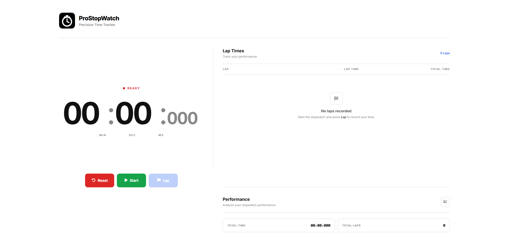
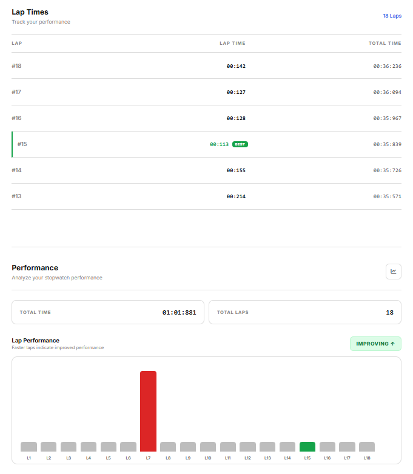
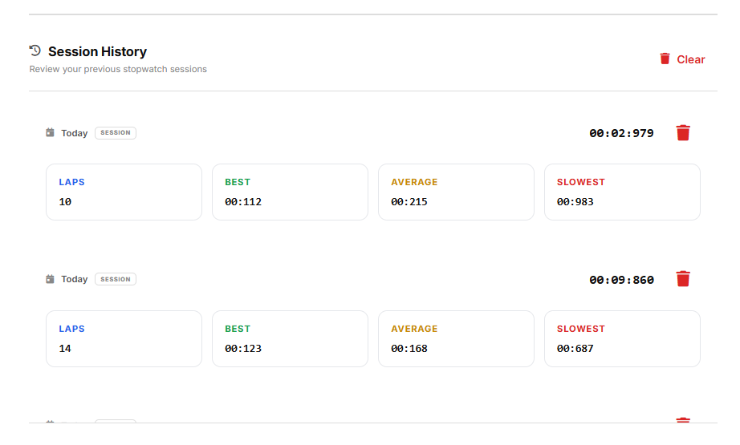
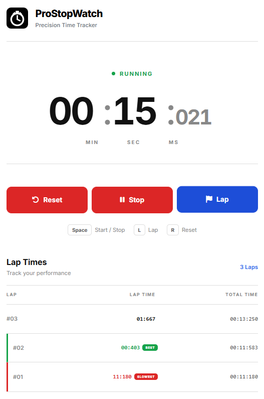

# ⏱️ ProStopWatch

A modern, responsive stopwatch web application that helps users track time, record lap times, analyze performance, and manage previous stopwatch sessions.

## 📌 About the Project

ProStopWatch is a feature-rich stopwatch web application built using HTML, CSS, and JavaScript.

The application provides stopwatch controls, lap tracking, performance statistics, lap-time visualization, and session history management. It uses browser `localStorage` to preserve session history between page refreshes.

The project focuses on a clean user interface, responsive layouts, meaningful performance indicators, and a smooth user experience across desktop and mobile devices.

## ✨ Features

- ⏱️ Start, pause, and reset the stopwatch
- 🏁 Record and track lap times
- 📊 View stopwatch performance statistics
- 🥇 Identify the best lap time
- 📈 Calculate and display average lap time
- 🐢 Identify the slowest lap
- 📉 Visualize lap-time trends with a chart
- 🗂️ View previous stopwatch sessions
- 💾 Persist session history using browser `localStorage`
- 🗑️ Delete individual sessions
- 🧹 Clear session history
- ⚠️ Confirmation dialogs for destructive actions
- 🎨 Color-coded lap performance indicators
- 📱 Responsive design for desktop and mobile
- ✨ Modern interface with smooth visual styling
- 🧭 Easy-to-use stopwatch controls
- 🔄 Restore saved session history after page refresh

## 📸 Screenshots

### Main Stopwatch



### Lap Times & Statistics



### Session History & Trend Chart



### Mobile View



## 🛠️ Tech Stack

### Frontend

- HTML5
- CSS3
- JavaScript (ES6+)

### Browser Features & Libraries

- Browser `localStorage` — persistent session history
- Google Fonts — typography
- Font Awesome — icons

### Deployment & Version Control

- Git — version control
- GitHub — source code hosting

## 🏗️ Project Structure

```text
ProStopWatch/
│
├── screenshots/
│   ├── stopwatch.png
│   ├── lap-statistics.png
│   ├── session-history.png
│   └── mobile.png
│
├── favicon.svg
├── index.html
├── script.js
├── style.css
└── README.md